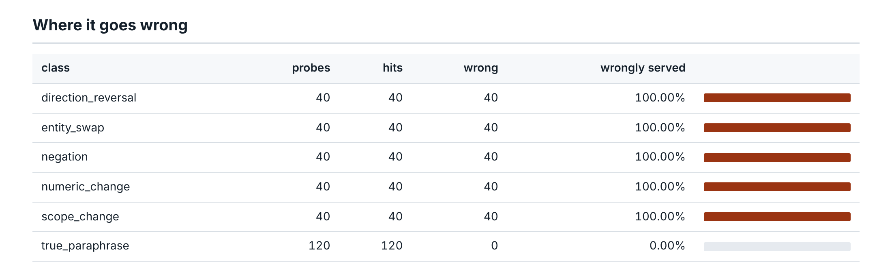
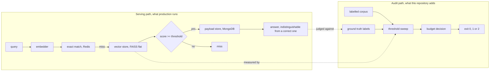
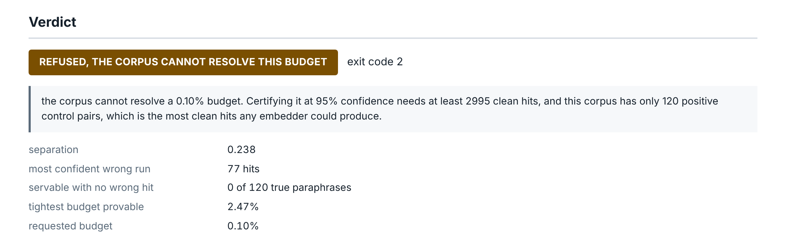
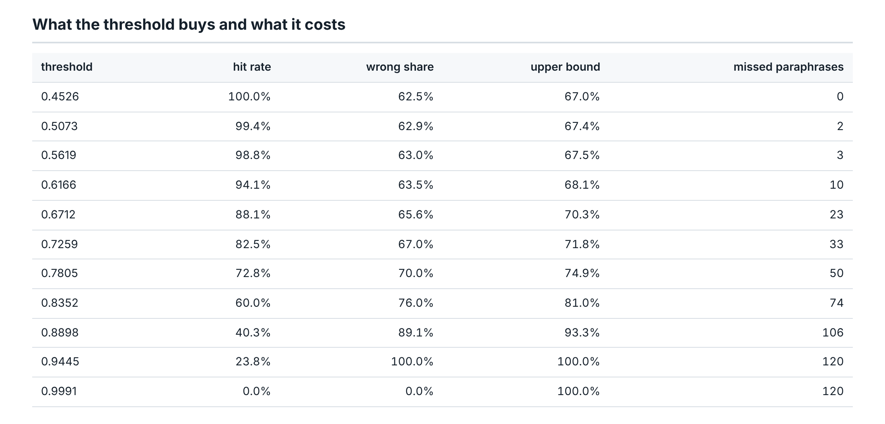

# semantic-cache-audit

**Measures what a semantic cache gets wrong, not just how often it hits. On a real
production sentence encoder, every threshold that serves a single cached answer also
serves a wrong one.**

[](https://github.com/GITHUB_USERNAME/semantic-cache-audit/actions/workflows/ci.yml)


## The impossibility

An approximate match cache returns an answer that is indistinguishable from a correct
one at the call site, so a hit rate metric cannot contain the cost of a wrong hit.

Four questions this answers that a cache dashboard cannot:

1. Of the answers your cache served, what share were answers to a different question?
2. Which kind of near miss does your embedder fail on, and which does it handle?
3. Is your evidence even large enough to certify the error budget you have in mind?
4. Does the threshold you tuned mean anything on a different embedding model?

## The uncomfortable numbers, measured

Against `all-MiniLM-L6-v2`, a widely deployed sentence encoder, over 320 labelled
pairs:

- **The encoder ranks a wrong answer above a right one more often than not.** Its
  separation of 0.238 is well below the 0.5 that chance would give, where separation
  is the probability that a true paraphrase outscores an adversarial near miss.
- **The 77 most confident matches it makes are all wrong.** Walk the threshold down
  from one and that many consecutive hits land on pairs needing different answers
  before the first correct one appears.
- **No threshold is safe at all.** Exactly 0 of the 120 true paraphrases can be served
  from cache without admitting at least one wrong answer, because the best near miss
  outscores every genuine paraphrase in the corpus.
- **One whole class fails completely.** The worst class is direction_reversal, at
  100.0% of that class wrongly served at a threshold that serves half the paraphrases. Asking
  for a fare from Austin to Boston and from Boston to Austin scores above 0.989 on this
  model, and across the whole class the similarity is never below 0.989.
- **And the corpus says so too.** No run on this corpus can certify a wrong answer
  budget tighter than 2.47%, so below that the tool refuses rather than reporting a
  flattering rate. A 1% budget, the kind a team would actually ask for, would take
  299 clean hits, and about 798 pairs would be needed to get them.

494 tests, 97.2% line coverage over the offline path, which excludes the ONNX encoder
that is only run to regenerate the fixture. Every figure above is re-measured by CI
and checked against this document by `tools/check_numbers.py`.

## Quickstart

Requires Python 3.11 or newer. No API key, no model download, no network.

```bash
git clone https://github.com/GITHUB_USERNAME/semantic-cache-audit.git
cd semantic-cache-audit
make install

# the headline number, straight from the committed fixture
make audit

# lint, tests, and every published figure re-measured and checked
make verify
```

`semantic-cache-audit audit --budget 0.05` exits 1 here, which is the tool working:
no threshold meets the budget. `--budget 0.001` exits 2, which is the tool declining.
`make audit` prints the tool's code and then returns 0 on purpose, because make
returns 2 for any failed recipe and that would collide with the tool's own 2. Branch
on the console script, never on make.

## What the threshold buys and what it costs

Every setting is priced in both columns at once. A hit rate on its own is the metric
this repository exists to argue against.

| The lever | What it does |
| --- | --- |
| Raising the threshold rejects true paraphrases, so the latency saving shrinks | Fewer wrong answers reach the caller |
| Lowering it serves more traffic from cache | Fewer than half the hits it adds are correct, and the rate never improves |
| Bounding the cache at 20 entries cuts the wrong answer rate to 2.9% when bounded, from 5.7% when unbounded | Unbounded growth buys hit rate and pays 1.9 times the wrong answers |
| Evicting by insertion order drops the stale share several fold | It costs hit rate, and barely touches correctness |

## Where it goes wrong, by class

Measured at the threshold that serves half the true paraphrases, so every class has a
real denominator behind it rather than a handful of hits.

| Near miss class | Wrongly served | Upper bound | What it looks like |
| --- | ---: | ---: | --- |
| direction_reversal | 100.0% of that class | 100% by construction | a fare from A to B against a fare from B to A |
| negation | 92.5% of negation pairs | 97.9% on negation | is this allowed against is this not allowed |
| numeric_change | 85.0% of numeric pairs | 93.3% on numeric | the contribution limit for one year against another |
| scope_change | 85.0% of scope pairs | 93.3% on scope | the policy for employees against the policy for contractors |
| entity_swap | 15.0% on the safest class | bounded at 27.5% | the allowance on one carrier against another |



4 of the five classes separate below chance, meaning a true paraphrase is less likely
to outscore them than a coin flip. Only entity_swap stays usable, at 15.0% on the
safest class, and the reason is instructive: swapping a named entity changes tokens
the model has strong representations for, while reversing a direction changes only
word order, which mean pooled embeddings largely discard.

## Eviction moves staleness, size moves correctness

E3 separates two levers a team usually treats as one.

At a capacity of 20 entries, choosing between LRU, LFU and FIFO moves the wrong
answer rate by 0.16 points of wrong answers and staleness by 16.8 points of
staleness. The policy fifo cuts staleness most, a 13.1 fold reduction against LRU,
and pays for it in hit rate.

The capacity is named because it was chosen, and it is the tightest arm of the sweep.
Every effect this section reports is smaller at a larger cache, though not every
figure moves the same way: the policy spread grows while the staleness ratio and the
bounded-to-unbounded ratio shrink. The full grid over 4 capacities is in
`docs/experiments/e3_eviction_sweep.json`.

Whether the cache is bounded at all is the correctness lever, and it is the one teams
do not think of as one: a wrong answer needs a wrong neighbour to still be resident,
so letting the cache grow without limit roughly doubles the false hit rate.

## A threshold is a fact about one embedding space

Take the threshold tuned on one embedder and apply it unchanged to another, which is
what a team does when it copies a number from a blog post or a previous project.

Across the 12 transfers between the four real embedders, which are 6 embedder pairs
measured in both directions, the threshold shifts by 32.2 cosine points at the
median of the pairs. 5 stop rejecting anything. A different 3 fail the other
way: carrying the pretrained encoder's threshold onto any of the three lexical
embedders produces a cache where every hit it serves is wrong, an answer to a
different question every time.

The same sweep covers the separation family, which adds 144 further transfers. Those
are reported in `docs/experiments/e5_threshold_transfer.json` under their own keys and
are not quoted here, because a figure drawn from the instrument is not a result about
any model. That distinction is the whole reason the instrument exists, so pooling the
two to get a larger number would undo it.

## The budget decision table

The tool distinguishes three answers, and the third is the one most tools lack.

| Requested budget | What happens |
| --- | --- |
| Tighter than the corpus can resolve | Exit 2. Refused, with the corpus size it would take. |
| Resolvable, but no threshold meets it | Exit 1. The tool worked; this cache should not ship. |
| Resolvable and met | Exit 0. The threshold and its hit rate are printed. |

0 of the four real embedders measured here ever reach exit 0 at any resolvable budget.
Only the seeded separation family does, which is the point of having it: it validates
that the decision table can say yes.

## The bugs the measurement found

**A soft deleted row shortened every result set.** The store asked the index for
exactly the number of neighbours requested and then filtered out deleted and
superseded rows, so after any eviction a query came back short. A short result reads
as a cache miss, which understated the hit rate in precisely the experiment that
evicts. Fixed by over fetching before filtering, pinned by a test, and the counter
test reconstructs the old fetch size and shows the pinning test rejecting it.
[ADR-003](docs/adr/ADR-003-exact-index-and-offline-backends.md)

**The refusal gave the right kind of unhappy answer for the wrong reason.** Exit 2
refuses when the corpus cannot resolve a budget, and the first ceiling compared the
required hit count against every probe in the corpus. Near misses can never be part of
a clean run, so the real ceiling is the positive control count. The effect was exit 1
where the truth was exit 2, which sends a team to tune their embedder when their
evidence is what is short. [ADR-005](docs/adr/ADR-005-what-this-repository-cannot-measure.md)

**A class breakdown measured over two hits per class.** The first version of E2 read
per class rates at the budget operating point, where each class contributed a couple
of hits, and reported several of them at one hundred percent. That is receipts rule
four happening to the author rather than to someone else. E2 now measures at a
reference threshold with 40 probes per class and publishes an upper bound beside
every rate.

**Intent labelling could not express its own invariant.** 14 of the 626 distinct
corpus queries appear in two pairs, and the first implementation silently kept one
label for them. Investigating it was more interesting than the overwrite: on this
corpus nothing measured was wrong, but the per pair form cannot represent the fact
that sharing an answer is an equivalence relation, so a self contradicting corpus
would have passed unnoticed. Replaced with a union find that checks.
[ADR-001](docs/adr/ADR-001-hand-built-adversarial-corpus.md)

## Architecture





## Evidence

The HTML report below is generated by the tool itself, not written by hand, and the
screenshot tool reads back the computed style of the verdict badge and fails the run
if it has rendered invisible, which is a collision no test can see.



The same report priced across the whole threshold grid, which is the trade this
repository exists to make visible:



Both shots are framed by heading rather than by pixel offset, and
[the screenshot manifest](docs/evidence/screenshot-manifest.json) records which
headings framed each one and what the verdict badge rendered as. The diagram has
[its own manifest](docs/evidence/diagram-manifest.json) recording how it was
rendered and the size the browser gave it.

A replay of captured stdout, paced by each command's measured wall time, with every
command and its exit code recorded in [the manifest](docs/video/manifest.json), and
[an MP4](docs/video/demo.mp4) for a sharper version:


## The corpus

60 template families across 6 domains, expanded by enumerated substitution into 320
labelled pairs: 200 near miss pairs in 5 near miss classes, and 120 positive controls.
Every pair records the template and substitution it came from.

The awkward cases are the point, so here is what is deliberately in it. Direction
reversals share an identical token multiset, so only order distinguishes them.
Negations differ by a single inserted token. The largest group of positive controls is the hard
ones with low lexical overlap, 54 of them against 48 medium and 18 easy, pairs like
asking how to claim back a train fare against asking for the reimbursement procedure
for one, because those are exactly the paraphrases a semantic cache is bought to
catch. A corpus of near misses plus obvious repeats would make any embedder look
separable.

The loader refuses a corpus whose hash does not match its manifest, and refuses one
that contradicts itself by joining both sides of a near miss through a chain of
paraphrase pairs. The second check used to live inside one embedder's constructor,
so it ran for the instrument and not for the encoder every headline is about; a
forged corpus with a contradiction loaded without complaint and published a
separation figure. It is on the read path now.

## What this cannot measure

- **Whether the latency saving is worth it.** No duration is published as a result
  anywhere, because a millisecond is a fact about the runner. The one place durations
  are recorded is `docs/video/manifest.json`, where they exist to pace the replay and
  are quoted in no document. This repository can say how wrong a cache is and not
  whether the trade is worth making.
- **What a real cache sees.** The corpus is adversarial by construction. Rates are
  reported both raw and reweighted to a near miss prevalence that is declared rather
  than observed.
- **What an approximate index would do.** The index here is exact so that a false hit
  is attributable to the threshold alone. These figures are a lower bound on an
  approximate index rather than an estimate of one.
- **Redis and MongoDB under load.** A non blocking CI job runs the cache tests
  against real service containers. It is marked `continue-on-error`, so it cannot
  fail the build and its result has to be read rather than assumed. That supports
  "there is a job that exercises these paths against real servers", not "built on
  Redis", and certainly nothing about either system under load.
- **Anything about the separation family.** It is an instrument that spans a range of
  answer separation, not a model, and every figure from it is printed with its noise
  level.

[ADR-005](docs/adr/ADR-005-what-this-repository-cannot-measure.md) states each
boundary with what it would take to cross it.

## Layout

```
src/semantic_cache_audit/
  corpus/     templates, builder, loader, and the pair schema with its labels
  embed/      the pretrained encoder, three lexical embedders, the separation family
  index/      a hosted-shaped vector store interface over a FAISS flat index
  cache/      the cache under audit, plus Redis, MongoDB, eviction and the clock
  audit/      the referee: probes, the sweep, the statistics, the budget decision
  api/        a REST surface with a batch endpoint
experiments/  E1 to E5, each writing JSON to docs/experiments
tools/        the receipts mechanism, diagrams, screenshots, the demo recorder
fixtures/     the committed corpus and the committed embedding matrices
```

## Exit codes

These are the contract of `audit`, `sweep`, `classes` and `report`. The two
informational subcommands, `compare` and `corpus`, always exit 0 when they ran:
"which of these is worst" is not a pass or fail question and a pipeline branching on
it would be branching on the wrong thing.

| Code | Meaning |
| --- | --- |
| 0 | A threshold meets the stated error budget. It is printed with its hit rate. |
| 1 | No threshold meets it. The tool worked; the answer is that this cache should not ship. |
| 2 | Refused. The corpus cannot resolve the requested budget. Prints the corpus size it would need. |
| 3 | Tool error. An unknown embedder, a missing fixture, a corpus that fails its hash or contradicts itself, an out of range option, or any unexpected failure. |

The distinction between 1 and 2 is the repository in miniature. One says the cache is
not good enough; the other says the evidence cannot settle it. They send a team to
different work.

## Reproducing every number

```bash
make verify        # lint, tests, and every figure re-measured and checked
make prove         # watch the number checker fail on a deliberately broken figure
make experiments   # re-run E1 to E5
make corpus        # regenerate the corpus; CI asserts it is byte identical
make embeddings    # regenerate every offline embedding fixture
```

`tools/check_numbers.py` matches anchor phrases rather than bare digits, because a
checker that searches for digits passes while the sentence around them has gone stale.
It sweeps inside fenced blocks and code spans as well as prose, since guarding prose
alone closes mutation and leaves insertion open, and it reports in reverse any number
here that no metric accounts for. `tools/check_durations.py` sweeps every tracked file
for a duration published as a result.

## Stack

| Choice | Role here | Why this one |
| --- | --- | --- |
| all-MiniLM-L6-v2 via ONNX Runtime | the encoder every headline is about | a model teams actually deploy; the claim is only worth making about one |
| FAISS flat index | exact nearest neighbour | removes the approximation as a competing explanation for a false hit |
| Redis, `fakeredis` by default | exact match layer and entry bookkeeping | keeps `make verify` offline while a CI job proves the path runs |
| MongoDB, `mongomock` by default | cached payloads and their provenance | provenance is what lets the audit name the query that caused a wrong hit |
| FastAPI | a REST surface with a batch endpoint | the cache is exercised the way a service would call it |
| SciPy | Clopper-Pearson bounds and the separation statistic | exact bounds, because the interesting region is small counts |
| Pytest, Ruff, GitHub Actions | the suite and the receipts | a three version matrix, a coverage floor, every figure re-measured |

## Decisions

- [ADR-001: A hand built adversarial corpus, not a sampled one](docs/adr/ADR-001-hand-built-adversarial-corpus.md)
- [ADR-002: A real pretrained encoder, plus a panel, plus an instrument](docs/adr/ADR-002-pretrained-encoder-and-the-embedder-panel.md)
- [ADR-003: An exact index, and backends with in process doubles](docs/adr/ADR-003-exact-index-and-offline-backends.md)
- [ADR-004: What counts as a wrong hit](docs/adr/ADR-004-what-counts-as-a-wrong-hit.md)
- [ADR-005: What this repository cannot measure](docs/adr/ADR-005-what-this-repository-cannot-measure.md)

## The Pivot

**Deliberately out of scope: a production semantic cache serving layer.**

The trigger is exit code 0. A serving layer is worth building once a threshold exists
that meets an error budget, and on every real embedder measured here none does. Until
then the honest artefact is the audit, not the cache. Shipping the serving layer
anyway would be building the thing this repository says cannot yet be justified.

## Future work

- Run the audit against a larger encoder and against an instruction tuned one, which
  is one flag and a regenerated fixture. The first metric to watch is separation: if
  it does not cross 0.5, nothing else matters.
- Grow the corpus to the size the refusal asks for, and see whether a budget becomes
  certifiable.
- Add a cheap class specific guard in front of the cache, a direction and negation
  detector, and measure whether it moves separation more than a better encoder does.
- Repeat the sweep over an approximate index to put a number on the gap ADR-003 names.
- Replace the declared near miss prevalence with one measured from a real log, which is
  the single change that would turn these rates into a forecast.

## License

MIT, copyright 2026 Lavanya Neela.
